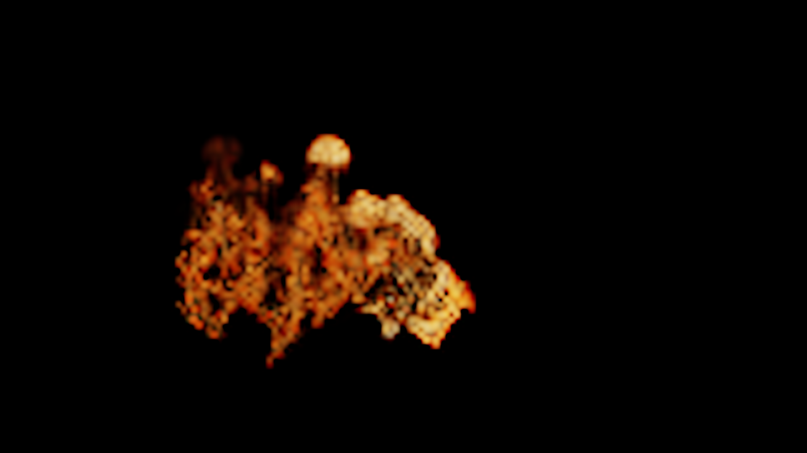

# Historical shared Fire/Air operator proof

These receipts precede the complete runtime consolidation. See
[the current review](../../SHARED_RUNTIME_REVIEW.md) for current scope and limits.

The local Windows CPU and CUDA runs compare the actual Fire/Air step functions
from `79ae673eee773cda972aaf4a56d1f0f0e1cd79a0` with the shared consumers.
Both receipts report 24 step comparisons with **zero absolute state error**.
The two tested 1920×1080 optical outputs are also byte-identical. These are
within-backend extraction comparisons, not CPU-versus-CUDA bit identity.

- [CPU receipt](cpu-parity.json)
- [CUDA receipt](cuda-parity.json)
- [Diagnostic frame receipt](fire-shared-flow-diagnostic.json)
- [Reproduction and full-film limits](../../../work/element-motion/SHARED_FLOW.md)

The image below is a real new simulation at **160×24×90**, integrated for 165
substeps, then rendered with the original 1920×1080 Fire optics. Its coarse
structures are diagnostic only; it does not represent the quality of the
896×56×504 full film. No still-derived animation or generated-image tool was used.

Full original-grid baseline/shared Fire and Air films are a separate regression
gate. Their receipts will be added when those runs complete; no full-film
success, engineering validation or historical-clock recovery is implied here.
