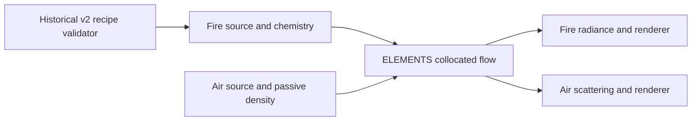

# Fire/Air shared flow

`sigil_02_fire_v2.py` and `sigil_02_air_v2.py` now execute
`element_flow.CollocatedFlow` for transport, vorticity confinement, pressure
projection and boundary relaxation. This removes the active duplicate operators.
The scripts still own their different source injection, reaction/passive-density
policies and optical renderers. Historical scripts remain historical source.



This is the existing collocated Torch graphics model. The shared module has
no dependency on the separate FLIP solver, native FIRE's staggered solver, or
pressure-fireball's compressible solver. Its state is `[1,8,Z,Y,X]`: velocity
xyz, fuel, oxygen, normalized temperature, soot and reaction rate. The existing
central-difference Fourier projection, border-extended grid sampling, periodic
derivatives and boundary sponge are preserved, including their limitations.
No new physical or combustion validation is claimed.

## Reproduce the differential checks

Python 3.12, PyTorch 2.6, NumPy and Pillow are required. The Git checkout must
contain ancestor `79ae673eee773cda972aaf4a56d1f0f0e1cd79a0`; the proof reads
its original function definitions instead of maintaining another solver copy.

```sh
python work/element-motion/sigil_02_build_v2.py --check
python work/element-motion/verify_element_flow.py --device cpu --report cpu-parity.json
python work/element-motion/verify_element_flow.py --device cuda --report cuda-parity.json
```

The checks compare all eight state channels after actual Fire/Air steps under
24 and 30 simulation FPS, with unsteered and directed control, at ignition,
writing and valve closure. Nonzero initial velocities exercise departures
across multiple cells. The unchanged original 1920×1080 renderers must also
produce byte-identical RGB pixels for the tested states. Constant-scalar
transport and divergence reduction provide separate numerical checks.

The optional `--diagnostic-dir <directory>` integrates 165 native substeps
from the real source field on a **160×24×90 diagnostic grid** and saves one
1920×1080 Fire frame. That image uses the original renderer but is explicitly
lower simulation resolution; it is not full-film parity or final visual quality.

The historical builder still verifies all twelve original text transformations
against their SHA-256 and verifies Fire's unchanged radiance. It now writes
recipe metadata only; it never regenerates/overwrites maintained solver code.

## Full-film regression remains a separate gate

Preserve all 294 frames, the 896×56×504 simulation domain, 1920×1080 output,
30 FPS encoder, CRF 17, custom Fire/Air source policies and frame-135 source
review gate. Run baseline and shared consumers with the **same explicit**
simulation FPS/substeps and compare state/pixel receipts across the entire
duration. Do not replace this with a six-second or reduced-grid preview.

The retained source report records geometry and a 9.8-second presentation, but
does not retain the original CLI invocation. The scripts default to **24
simulation FPS**, whereas the encoder uses **30 FPS**: 294 frames therefore
integrate 12.25 simulation seconds at that default. This extraction does not
change that clock. New film reports record simulation FPS, substeps and elapsed
simulation duration explicitly. Matching the historical published film's clock
still requires its original invocation or an explicitly selected new baseline.

The scripts require CUDA for their production bake, ffmpeg on PATH, and the
retained `sigil-02-v2/source.npz`. CPU CI tests the operators and render math;
it does not certify full production films, CUDA support on macOS, or physical
combustion. No full-resolution film rerender has yet been claimed here.

### Serial full-grid receipts

`render_flow_regression.py` executes the actual pinned/current consumer
functions in an isolated namespace, bypassing only their argument parsing and
fixed output filenames. It preserves the full simulation, original optics,
encoding settings and frame-135 visual review gate. Each frame records hashes
of all float32 state bytes and the exact RGB pixels before lossy video encoding.
State hashing streams the same C-order bytes in small slabs to bound host RAM.

```sh
python work/element-motion/render_flow_regression.py --element fire --version baseline --simulation-fps 24 --output proof/fire-baseline --gate-file proof/continue-fire-baseline
python work/element-motion/render_flow_regression.py --element fire --version shared --simulation-fps 24 --output proof/fire-shared --gate-file proof/continue-fire-shared --reference proof/fire-baseline/frames.jsonl
```

At each frame-135 gate, inspect the saved PNG before creating the specified
continuation file. Repeat the pair with `--element air` and separate output/gate
paths. Run one GPU process at a time. Existing output directories are rejected.
These explicit-clock rerenders do not claim to reproduce the undocumented
invocation of an older published MP4.

### New source example, existing solver

The example generator below creates two counter-rotating circular inflow
paths. It supplies only source support, arrival times and tangents. The existing
Air consumer still supplies passive-density injection, shared transport/pressure
and its native optical renderer; no additional solver or downstream path is added.

```sh
python work/element-motion/examples/counter_rotating_sources.py --output proof/counter-rotating-source.npz
python work/element-motion/render_flow_regression.py --element air --version shared --simulation-fps 24 --source-fields proof/counter-rotating-source.npz --output proof/air-counter-rotating --gate-file proof/continue-air-counter-rotating
```

The example uses the same full grid, 294 frames and 1080p output. Its rendering
must be run and inspected before describing its visual result as verified.
